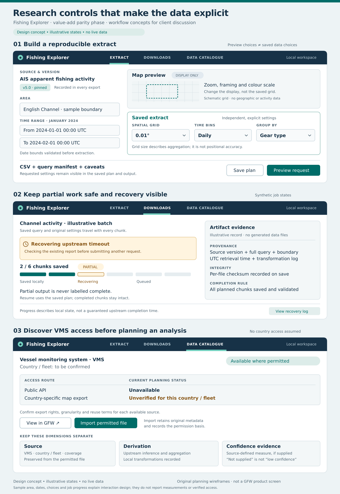

# Phase-one screen concepts

**Concepts for discussion · 23 October 2026 · no application or live data**

These original wireframes illustrate three decisions in the [specification](parity-phase-specification.md): keep preview and saved detail separate, preserve partial historical work, and explain VMS access before users plan an extraction. Values, dates and job states are illustrative. The image is not a screenshot of GFW or a claim of verified v5/VMS access.



[Editable SVG source](assets/parity-workflow.svg) · [Full-resolution PNG](assets/parity-workflow.png)

## A. Build a reproducible extract

The selected source/version, area and exact UTC bounds remain visible alongside the saved grid, time bin and grouping. A researcher should be able to describe one output row before submitting. The schematic grid only identifies a preview surface; it is not a geographic map or measured fishing data.

The shown end timestamp represents the start of the next month, using the proposed internal half-open interval. Production copy must make inclusivity clear and the adapter must first verify GFW's bounds. Preview should also display its effective spatial and temporal aggregation, including when it differs from the saved output.

Test: ask a researcher to change the map zoom, then explain whether the saved grid or dates changed. Ask them to find the dataset version and distinguish aggregation scale from observation accuracy.

## B. Recover a historical job

The downloads view keeps committed settings, saved partitions, missing work and provenance together. “2 / 6 chunks saved” is a synthetic local-progress example; it is not an estimate of server completion. A timeout leads to correlation/recovery before any resubmission. A completed partial file remains labeled partial.

Test: show this state after a simulated interruption. Ask what is safely stored, what remains uncertain and what Resume will do. The correct explanation must not assume that cancelling locally cancels an upstream report.

## C. Discover VMS access

The catalogue gives a source a useful place even when its public API is unavailable. Country/fleet selection, map export, local retention and reuse rights need verification. “Import permitted file” is a concept action; it is enabled in a release only for a supported schema and permission basis. It is not an implied existing dataset.

Test: ask the researcher to explain the difference between map visibility, API access and an authorized file. Ask whether a missing confidence field means low confidence. Source, derivation and supplied quality evidence must remain separate in their answer.

## D. Comparison concept to develop at the checkpoint

```text
COMPARE STUDIES                                   Saved comparison draft

Area: same frozen polygon       Dates: aligned periods       Units: visible

LEFT: AIS apparent fishing activity     RIGHT: offshore reference layer
Dataset/model + artifact ID            Publisher + validity period + rights
Map and time series                    Map / context features
Own legend: apparent fishing hours     Own legend: installation / concession

Compatibility: source, coverage, dates and units shown side by side
Interpretation: geographic overlap is descriptive; no causal effect inferred

[Inspect methods]  [Review comparison settings]  [Export figure and sources]
```

For two periods of the same measure, use matched scales and a labeled difference view after validating compatibility. For different sectors, preserve separate units and legends. A deep-sea-mining concession boundary must not look like a measurement of current mining intensity. Build this concept around client-supplied reports/layers once received.
