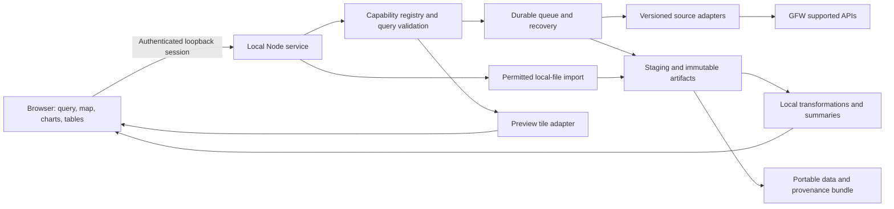
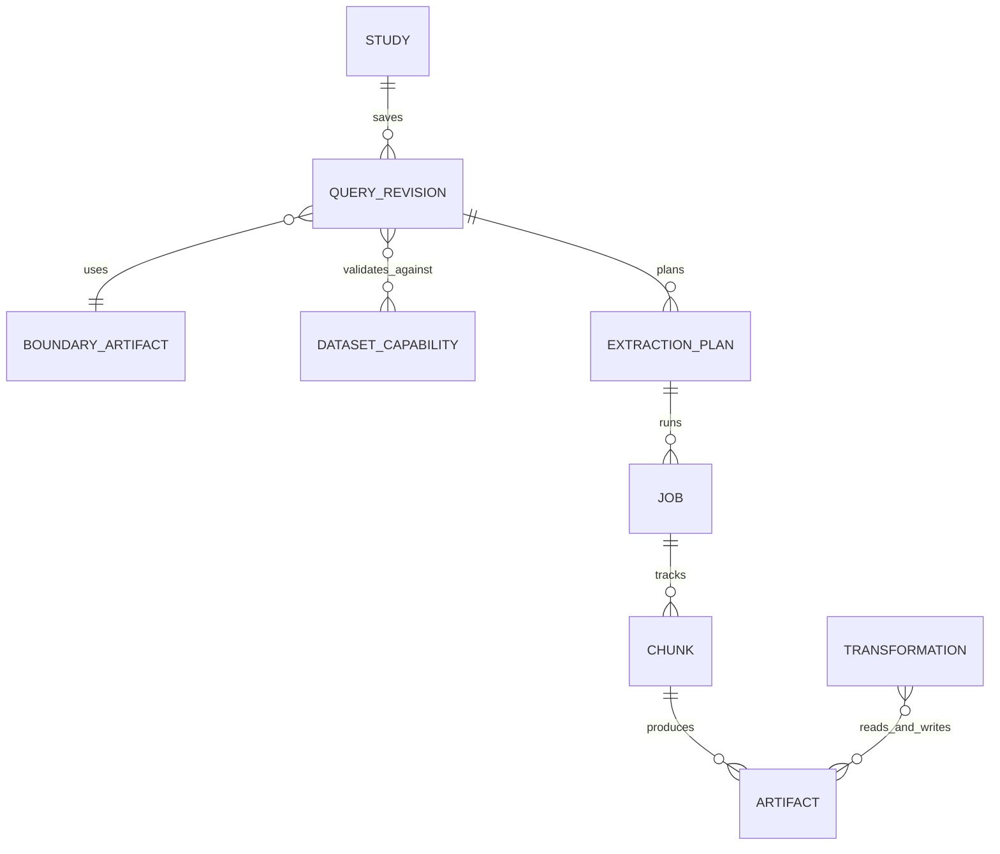
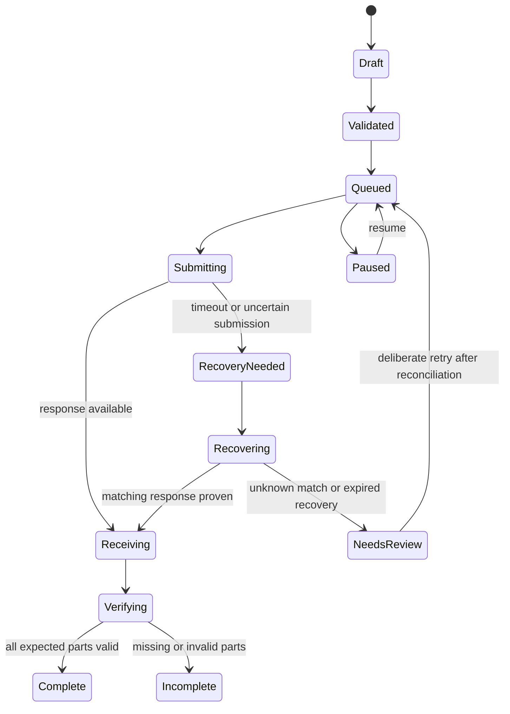

# Value-add parity: architecture, backlog and delivery plan

**Draft · 23 October 2026 · implements the [phase-one specification](parity-phase-specification.md)**

The first deliverable is a small, reproducible extract workflow running on a representative client machine. Prove permissions, data semantics and packaging before expanding the map. Advance to broader parity through independent source adapters and a common study/artifact model.

## 1. Discovery gates and critical path

Gates require evidence, not necessarily a new permission prompt to the user. Discovery, fixtures and UI design can proceed while external questions are unresolved. Live operation and restricted data integration wait for the relevant gate.

| Gate | Evidence to obtain | Exit / fallback | Owner |
| --- | --- | --- | --- |
| **G0: use and licensing** | Intended client use; API terms applicability, including derivative-product clause; source-code reuse inventory; required data attribution. | Record supported use basis before live pilot. Proceed with independent design and synthetic fixtures while clarification is pending. No blanket MIT assumption for upstream. | Project sponsor + engineering; consult GFW/licensing reviewer as needed |
| **G1: VMS access** | Dated country/fleet inventory; export route, grain, schema, retention/transform/share rights; authorized representative sample. | Enable tested import first. Direct connector requires supported access. If none is available, client explicitly accepts an AIS-focused release or revises the programme; do not call discovery “VMS parity.” | Data lead + client + GFW/authority |
| **G2: managed runtime** | Actual Node/browser/OS, loopback execution, writable directories, proxy/TLS/redirect access, WebGL, package launch on a standard account. | Select runtime floor and release packaging. If blocked, request a documented IT-approved deployment path; no security-policy bypass. | Engineering + client IT |
| **G3: API contract** | Tiny v5 samples, resolved-version headers, actual output containers, schemas, supported filter/grain combinations, no-data shape and pagination. | Enable only verified capabilities in the registry; keep v4 probes as historical evidence. | API/data engineer |
| **G4: extraction correctness** | UTC/date inclusivity, cell boundaries and clipping, chunk vs whole totals, recovery correlation and practical size measurements. | Enable historical batches inside a measured envelope. Until then, single bounded extracts and explicit recovery limitations. | API/data engineer + science reviewer |
| **G5: pilot readiness** | End-to-end acceptance tests, client-machine package, portable bundle verification, usability review and resolved release scope. | Release supported capabilities with a dated matrix; leave conditional items visibly unavailable. | Project lead + client |

Critical path: **G0/G2/G3 → one extract → integrity/recovery → historical batches (G4) → pilot (G5)**. G1 runs from day one in parallel because it may change the project's value proposition; it must not be hidden at the end of the backlog.

## 2. Proposed architecture



**Browser:** TypeScript and React are the preferred starting point, with a small client build and lazy-loaded map code. Evaluate MapLibre and the necessary deck.gl/GFW components in a compatibility spike; record exact package versions/licenses when selected. Use native accessible forms and a shared query model. The choice is provisional, not a mandate to transplant upstream state management.

**Local service:** serves bundled assets, holds the personal token in memory, validates requests, owns durable jobs, streams data to disk and exposes typed local operations. It starts without contacting GFW. No production dependency on a development server or an external CDN. A prebuilt distribution avoids build tools on the client machine.

**Persistence:** start with immutable files, per-job state records and an append-only transition log with crash-safe promotion and a single writer. Build an index that can be reconstructed from manifests. Benchmark before adopting a database. SQLite, DuckDB, Parquet and GeoParquet are options only after runtime, native/WASM dependency and file-size tests; none is a required binary installation in the baseline. A user-selected local workspace is preferable to an untested synced/roaming folder.

**Processing:** baseline computations are filtering, explicit aggregation and descriptive comparison. Stream file decoding/encoding and perform expensive transformations off the UI thread. Set supported file-size/row budgets from measurements. Phase one does not require a global analytical database on every laptop.

**Upstream reuse decision:** prefer independent application composition and documented public endpoints. Assess `api-types`, selected API-client utilities and tile loaders individually for licensing, compatibility, payload size, hidden development defaults and browser/server assumptions. Keep an adapter boundary so a library can be replaced. Do not vendor the platform app into this MIT repository without resolving its GPLv3 license. [Source evidence](gfw-parity-evidence.md#source-review)

### Alternatives considered

| Option | Benefit | Material cost / decision |
| --- | --- | --- |
| Fork the whole GFW platform | Fast access to broad UI behavior and existing map code. | Large toolchain, product-specific auth/services and mixed licensing; not the default. |
| Browser-only SPA | Simple hosting and no local server. | Token handling, long-job persistence, file limits and reliable offline data management become harder; not the initial research runtime. |
| Static UI + local Node | Fits available runtime, streaming and persistent files; straightforward local packaging. | Must protect loopback routes and prove client policy compatibility; preferred. |
| Electron / native desktop | Native file/credential integration. | Binary installation/update policy and packaging burden; defer. |
| Hosted/serverless service | Centralized updates and potential collaboration. | Credentials, rights, infrastructure costs and long-running jobs need a separate design; low priority. |

## 3. Adapter and capability contract

An adapter accepts a validated `QueryRevision`, produces an `ExtractionPlan`, executes/resumes chunks and yields a validated artifact plus source metadata. It must not take arbitrary user SQL, arbitrary URLs or hidden UI state. Build filters from whitelisted typed fields and escaped values.

The capability registry should be checked in for known supported contracts, refreshed with dated source metadata where available, and refined by permitted probes. Do not assume an undocumented universal discovery endpoint exists. Track the evidence for each capability: `documented`, `source-observed`, `probe-verified`, `permission-confirmed`, `unknown` or `unsupported`. Evidence and runtime health are separate.

| Source family | Supported integration surface to validate | Planned role |
| --- | --- | --- |
| Gridded activity / presence / SAR | Public 4Wings tile, interaction, report, stats and bins routes | Tile preview; explicit report extraction; cell drill-down; stats/bins are not substitutes for regional data. |
| Vessel identity | Public vessel search/detail | Typed identity records, historical identifiers and provenance. |
| Events / insights | Public event list/detail/statistics and documented insights routes | Paginated inspection and source-defined indicators; separate adapters/quality semantics. |
| Region / infrastructure context | Public Context Layers API | Named regions and filtered MVT infrastructure. Retain boundary version/geometry. |
| Infrastructure bulk | Documented asynchronous Bulk Download API | Optional P1 infrastructure extracts with job IDs and signed-file retrieval. This is not a fishing bulk endpoint. |
| Historical releases | User-selected permitted release files; documented download routes where supported | Schema/version-aware local import; do not assume old releases equal current API products. |
| VMS | Permitted file import; supported partner route only if confirmed | Country/product-specific capability and license record. No inferred public API entitlement. |
| Client overlays | Validated local GeoJSON/CSV | Local context, attribution, validity dates, and explicit privacy boundary. |

Public references: [4Wings](https://globalfishingwatch.org/our-apis/documentation/docs/v3/4wings), [Vessels](https://globalfishingwatch.org/our-apis/documentation/docs/v3/vessels), [Events](https://globalfishingwatch.org/our-apis/documentation/docs/v3/events), [Context Layers](https://globalfishingwatch.org/our-apis/documentation/docs/v3/datasets), [Bulk Download](https://globalfishingwatch.org/our-apis/documentation/docs/v3/bulk-download). The source review identifies additional first-party routes; their presence does not make them part of this supported contract.

### Query and manifest model



Minimum canonical query fields:

- Schema version; study/revision IDs; source family; API route version; requested and resolved dataset versions.
- Region ID/source version **and** frozen geometry when available, or exact custom geometry; input and transmitted geometry hashes; validation/simplification record.
- UTC start and exclusive end; adapter's proven upstream boundary mapping; spatial grid/CRS; time bin; metric/units; grouping and typed filters.
- Output format, intended product, permission basis and capability-evidence revision.

Do not include study/revision/job IDs, titles, viewport, colors, credentials or signed URLs in the extraction/cache semantic hash. Identical permitted queries in different studies can reuse the same artifact, while each study retains its own revision identity. Preserve full coordinate precision and filter meaning; JSON key ordering is safe to canonicalize, lossy geometry rounding is not. Record requested/catalogue-resolved versions and any response-reported version separately; absence of a version header is explicit, never fabricated. Unresolved `latest` cannot become a reproducible multi-chunk plan until a concrete version is established.

Each manifest additionally records:

| Group | Required content |
| --- | --- |
| Identity | Manifest schema version; artifact/job/query IDs; application build; parent artifact IDs and hashes. |
| Request evidence | Redacted method/path/parameters/body or private retained request file; requested/resolved datasets; exact transmitted bounds and geometry; request hash. |
| Source semantics | Units, schema, missing/suppressed value conventions, grid definition, date coverage, clipping rule if known, product/model versions. |
| Retrieval | Start/end UTC times; safe response-header allowlist including `x-datasets`; status; format/container; upstream job/request IDs when provided. |
| Integrity | Original byte size and SHA-256; per-file hashes; validation result; all expected and completed partitions; explicit complete/partial status. |
| Rights | Source citation, terms/caveats/license references and verification date; bundled permitted caveats; retain/transform/redistribute restrictions. |
| Transformation | Code revision, parameters, input hashes, aggregation and identity rules; all derived outputs labeled as such. |

Manifests may themselves contain confidential study geometry. Keep full provenance locally; provide a preview of a shareable bundle and redact only with an explicit record of omitted information. Never claim that a redacted study is fully reproducible when essential geometry is absent.

## 4. Historical jobs, recovery and caching

Use separate **job lifecycle**, **chunk lifecycle** and **artifact completeness** fields. A paused or failed job can contain valid completed chunks; a successfully saved partial bundle is still incomplete.



Authentication required, bounded retry wait, permanent failure and local cancellation are additional explicit states, not aliases for empty results.

Execution rules:

1. Validate capabilities, use basis, geometry, dates and storage budget; resolve dataset versions once for the plan. Persist the plan before submission.
2. Prefer existing compatible archived data. New retrieval creates a new artifact even for the same query. Pinning a version does not imply the upstream bytes are frozen.
3. Use a single report worker and process/workspace lock. The upstream per-user limit also spans other apps/tokens; local locking cannot guarantee exclusive remote ownership.
4. Persist “submitting” before network I/O. A lost response is uncertain upstream state, not permission to submit again.
5. Recover a 524 using the supported last-report flow before retrying. The documented recovery period is 30 minutes after generation. Verify query identity before attaching recovered bytes. [Recovery contract](https://globalfishingwatch.org/our-apis/documentation/docs/v3/4wings/last-report)
6. A running response may expose a URI but a completed payload may lack full correlation metadata. Validate dataset, boundary, dates, filters, grain and format wherever available. If association cannot be established, isolate the candidate and require deliberate review/retry; never silently declare success. Another GFW tab can own the last report.
7. Stream to a staging file, detect actual content/container, validate schema and archive members, compute hashes, then promote atomically where supported. State and files must reconcile after crashes between each step.
8. Save a chunk before starting the next. Prefer disjoint, bin-aligned time windows; verify endpoint inclusivity. Do not independently sum full-period unique-vessel counts from chunks. Keep a clear completeness ledger.
9. Retries use bounded exponential backoff/jitter and `Retry-After` where supplied. Treat authorization, unsupported input, concurrency and quota errors differently. Rate headers may lag; do not use them as an exact remaining-call meter.
10. Pausing/cancelling stops local future work and records unresolved upstream activity. Do not advertise a remote cancel unless supported and tested. Show phases, elapsed time and verified chunks rather than fabricated completion percentages.

Default retry budgets and chunk thresholds are implementation configuration to calibrate in G4, not guessed public service limits. For example, the upstream UI's configurable 366-day guard is evidence of its UI policy, not proof of a universal API maximum or authorization to work around one.

Cache keys include all data semantics and the capability/schema revision. Store mutable metadata separately with a checked-at timestamp/expiry. Evict reproducible derived previews before unique raw artifacts; surface disk usage and user-controlled cleanup. Do not delete the only copy of an extract as an invisible cache optimization.

## 5. Local distribution, security and privacy

Implemented preview layout; representative managed-machine acceptance remains subject to G2:

```text
fishing-explorer-release/
  start.cmd                   # Windows launcher; managed Windows pilot pending
  start.sh                    # POSIX launcher (run with sh)
  scripts/launch.mjs           # verified launcher with separate per-user data defaults
  scripts/verify-release.mjs   # listed-file integrity check
  server/index.mjs            # prebuilt JS service
  public/                     # bundled UI, fonts and required worker assets
  examples/                   # clearly synthetic or licensed sample bundle
  THIRD_PARTY_NOTICES.md
  release-manifest.json
  README.html                 # setup, start/stop, data locations and support
  checksums.txt
```

Research data lives in a user-selected writable workspace outside the application release folder, so updates do not overwrite studies. Use a staging upgrade and retain a previous compatible release; migrations are versioned and never rewrite raw artifacts. `npm run package` builds a deterministic preview ZIP from an explicit runtime allowlist, with a synthetic example and external ZIP checksum. The packaged direct command is `node scripts/launch.mjs`; it verifies listed files and uses a separate per-user workspace by default. The developer checkout retains `node server/index.mjs` / `npm start` and its `local-data/` default. The launcher does not copy or migrate research data automatically. Windows/Intune, client proxy/CA settings and real standard-account acceptance still require G2 evidence.

Protect the local service even though it runs on the same machine:

- Bind loopback only, on an unprivileged port; handle conflicts without exposing the service to the LAN.
- Authenticate both data reads and mutations using a per-launch local session; validate Host/Origin and protect against cross-site requests and DNS rebinding. Avoid wildcard CORS and arbitrary URL/file proxy routes.
- Keep the GFW token in memory by default. Restarted online jobs pause for authentication; saved data remains readable. Do not put tokens in localStorage, URL parameters, bundles, logs or crash reports. Persistent credential storage is optional only after an approved secure mechanism passes G2.
- Use allowed upstream hosts and safe redirect handling; strip credentials on untrusted redirects. Treat signed download URLs as secrets. Package frontend assets locally; network requests still expose selected query geometry to GFW and map extents to a basemap provider.
- Validate ZIP entry paths, compressed/uncompressed limits and schemas. Restrict local file access to explicit user selections/workspaces. Sanitize imported labels and spreadsheet exports.
- Respect institutional proxy and trusted-CA configuration. Node support is version-dependent, so test the installed runtime/transport combination; never disable TLS verification. [Node CLI reference](https://nodejs.org/api/cli.html)
- Provide redacted local diagnostics, with user preview before sharing. No mandatory analytics, telemetry or remote client-data upload.

Record software notices separately from data licenses. The API terms, country agreements and imported-layer rights are release inputs; the existing repository license remains unchanged. GFW's website terms prohibit scraping for data, so unsupported extraction is not an architectural fallback. [Website terms](https://globalfishingwatch.org/terms-of-use/)

## 6. Ordered product backlog

This is the initial backlog update. IDs are stable for future issues/PRs. Effort bands are planning estimates for focused engineering work, excluding external waiting: **S = 1–2 days, M = 3–5 days, L = 6–10 days**. Items are not equally parallelizable; estimates are not a contractual schedule. The four-week slice deliberately implements a small subset of each larger item.

| ID | Priority / effort | Deliverable and done condition | Depends on | Spec |
| --- | --- | --- | --- | --- |
| B01 | P0 / M | Capability and rights register; dated VMS inventory, supported public surfaces, unresolved questions and use basis reviewed. | G0/G1 discovery | R02, R13 |
| B02 | P0 / M | Clean prebuilt shell launches on managed machine; storage/proxy/CA/WebGL diagnostics captured. | Client IT access, G2 | R14, R17 |
| B03 | P0 / M | Query, boundary, capability and manifest schemas; canonicalization and migration fixtures pass. | B01 | R01, R03, R09 |
| B04 | P0 / M | Tiny v5 contract probes and sanitized fixtures; parser/format/version matrix published. | G0, B01 | R04–R07 |
| B05 | P0 / L | Task-led extract builder with minimal named-area lookup, drawing/import, exact settings, geometry validation, coverage and disabled-capability explanations. | B03, B04 | R01–R05, R15 |
| B06 | P0 / L | One-source map preview plus tables/time series; committed-query labeling and missing-data states. | B04, B05 | R07, R12 |
| B07 | P0 / L | Durable report queue, streaming validation, cancellation semantics and recovery; crash/failure matrix passes. | B03, B04 | R06, R17 |
| B08 | P0 / M | Snapshot library and portable bundle; second-machine/offline reopen with matching hashes. | B03, B07 | R08, R09 |
| B09 | P0 / L | Historical planner: safe bins/partitions, quotas, disk budgets, chunk reconciliation and measured limits. | B07, B08, G4 | R04, R06 |
| B10 | P0 / M | Source/lineage/quality inspector and propagated citations/permissions; no invented quality scores. | B01, B03, B06, B08 | R12, R13 |
| B11 | Conditional P0 / M–L | First permitted VMS import adapter, sample manifest and source-specific display/filter semantics. | G1, B03, B08 | R02, R07, R12 |
| B12 | P1 / M | Static-release importer with schema/version detection and supported sample files; no live/static splicing. | B08 | R08, R09 |
| B13 | P1 / L | AIS presence and SAR adapters, per-product units/coverage/filter validation and figures. | B04, B06, B10 | R02, R07 |
| B14 | P1 / L | Vessel identity and event explorer with safe pagination, source histories and event confidence semantics. | B04, B07, B10 | R16 |
| B15 | P1 / M | Context-region display beyond B05 lookup, infrastructure overlay and licensed client GeoJSON/CSV overlays. | B03, B06, B10 | R03, R10 |
| B16 | P1 / L | Period/source comparison with alignment, mismatch explanations, zero-baseline handling and provenance. | B08, B10, relevant source adapters | R11 |
| B17 | P1 / M | GeoTIFF validation/export; printable figure/report with units/caveats; optional format adapters assessed. | B08, B10 | R09 |
| B18 | P1 / M | Local vessel sets/annotations and saved figures; identity/version references round-trip. | B14, B08 | R01, R16 |
| B19 | P1 lower / M | Supported GFW insights presentation and infrastructure bulk retrieval, with product-specific status/quality. Split into separate issues at implementation. | B13–B15, contract/rights evidence | R10, R12, R16 |
| B20 | Conditional / spike M | AIS tracks, selected map-only products or partner VMS route: verify contract/license, sampling and intended benefit before implementation estimate. | G0/G1, B01 | R02, R16 |
| B21 | P0 then P1 / L | Accessibility, usability and release hardening throughout; managed-machine and second-machine pilot pass. | Each vertical slice; G5 at release | R13–R17 |

Do not order B11 late simply because its implementation depends on access: B01/G1 starts immediately and is reviewed every milestone. If VMS is essential and unavailable, escalate the product decision before investing in broad AIS parity.

## 7. Milestones and staffing assumptions

Planning basis: one primary engineer with part-time science/product review. The first four weeks target a vertical slice, not all estimated effort above. Adding the stated bands gives roughly **48–80 engineering days for P0**, excluding conditional VMS, plus **33–55 days for the listed P1 breadth**, before external waiting or rework. These rough totals illustrate why broad parity is a multi-month programme for one engineer; they are not a completion-date forecast. Confirm capacity, scope and estimates after G0–G4. A second engineer can separate UI from adapter/jobs work once B03 stabilizes, but cannot eliminate external access delays.

| Milestone | Indicative timing | Demonstrable result / exit |
| --- | --- | --- |
| **M1: feasibility and visual contract** | Week 1 | G0/G1 issues recorded; G2 attempt on actual machine; v5 contract plan; client reviews screen concepts and first pilot geography. |
| **M2: one real extract** | Week 2, after access gates | One AIS source, small region, explicit grid/time/grouping, streamed raw result and manifest. Synthetic-only fallback clearly labeled if live use remains unresolved. |
| **M3: a saved study** | Week 3 | Table/chart from the same result, offline reopening, visible source/version, and controlled failure/recovery demonstrations. |
| **M4: client visual checkpoint** | Week 4 | Packaged slice; tasks below; VMS decision and updated scope/estimates. Proposed date is 20 November 2026 only if kickoff is 23 October; no meeting has been scheduled. |
| **M5: dependable P0 pilot** | Re-estimate remaining work at M4 against the 48–80-day P0 total | Measured historical batching, full recovery/integrity tests, storage and accessibility hardening, permitted VMS import if available. |
| **M6: agreed parity breadth** | After core contracts stabilize; schedule from the P1 effort bands and actual capacity | P1 adapters, comparisons, context and exports in client-priority order. Each source has its own acceptance record. |
| **M7: phase-one release and phase-two decision** | After G5, not date-driven | Supported matrix signed off, limitations documented, maintenance owner identified, next research questions selected. |

If timeline or capacity tightens, defer insights, bulk infrastructure, animation and conditional track integration first. Preserve extraction correctness, access clarity, managed setup and provenance. Do not compress these into the final week to keep a feature count.

### Four-week demonstration and research protocol

Meeting agenda clarification: the client is an academic/non-commercial nonprofit. Explicit VMS provider authorization is unknown. Ask whether they hold a provider agreement or authorized export/sample, the country and product involved, and the permitted retention, analysis, publication and redistribution actions. Record the evidence separately from intended use; nonprofit status does not close G1/B11.

Use a small authorized real extract for the working slice and visibly synthetic states for failures or inaccessible products. Do not imply the sample v4 measurements from 9 October are new v5 results.

1. Researcher selects a polygon and exact historical month, explains the preview/export resolution distinction, and chooses a daily grid by gear.
2. Review page shows the row meaning, dataset version and output plan. Run one small permitted extract; show stored data and query, not just a heatmap.
3. Reopen the same artifact offline; show its hash and caveats. Demonstrate a fixture-driven timeout/restart state without deliberately overloading the real API.
4. Open the VMS catalogue; explain country-specific uncertainty and the next permitted action. If an approved sample exists, import it; otherwise show why the gate remains open.
5. Review a comparison storyboard with fishing and a client-approved sector layer, keeping units, dates and methodology visible.

Run the same extraction task in GFW and the prototype with 3–5 representative participants. Capture completion, mistakes, assistance, time to a prepared extract, and ability to explain source/grain/coverage. Show comparisons fairly: GFW already has resolution and reporting tools. Obtain client feedback on the task sequence and terminology before polishing every screen. Store observations separately from speculation.

## 8. Verification strategy

Routine CI uses synthetic or appropriately licensed/redacted fixtures. Small live contract checks are opt-in, bounded, use the developer's own credentials and record evidence dates without logging tokens. Public docs and upstream source are contract inputs, not substitutes for measured behavior. No application tests were run as part of this documentation task because no application exists yet.

| Test group | Critical cases | Pass condition |
| --- | --- | --- |
| Contract/schema | Actual v5 versions; JSON vs ZIP; null dataset entries; HTML denial page; malformed/unknown required fields | Parse supported products accurately; reject or quarantine unexpected payloads; never report an error page as data. |
| Resolution | All enabled dataset/grain/time/group/format combinations; preview detail changes | Supported settings survive query → request → manifest; display changes cannot alter queued output. |
| Time/geometry | UTC, DST display, leap days, edges, holes, multipolygons, antimeridian and polar inputs | Verified semantics or clear preflight rejection; chunk union matches a small unsplit control. |
| Numerical correctness | Additive hours; regional totals vs compatible cells; uniqueness; absent/zero/suppressed values | Reconcile additive fixtures with initial tolerance `abs(error) <= max(1e-6, 1e-8 * abs(reference))`; any live difference beyond this is investigated for semantics before changing tolerance. No invalid distinct-count addition. |
| Version drift | `latest` changes; response version differs from request; deprecated dataset | Old artifact remains intact; mismatch halts/flags retrieval; no silent replacement or mixed-model trend. |
| Queue/concurrency | Duplicate click; second local tab/process; external report; concurrency vs quota 429 | Single local worker, correct error classification, bounded retries and no token rotation to evade limits. |
| Recovery | 524; network loss after submit; wrong/expired last-report; insufficient correlation | No blind duplicate or wrong-artifact completion; unresolved association remains visible. |
| Crash/partial work | Kill before submit, after submit, mid-write and during final promotion | Reconcile persisted intent and files; completed chunks retained; missing parts prevent complete status. |
| Cancellation | Paused queue; local download abort; upstream unknown | No false claim of remote cancellation; resuming preserves committed settings. |
| Storage/import | Disk full, locked/read-only file, path spaces/non-ASCII, corrupt/oversized ZIP, traversal, malformed geometry | Existing data survives; limits enforced; useful safe diagnostics. |
| Pagination | Next offset, repeated offset/page, interrupted sequence, duplicates | Detect loops; deduplicate only with validated keys; expose partial status until exhausted. |
| Permissions | VMS unsupported; export/reuse changes; mixed allowed/denied sources | Explicit exclusions and plan revision; no silent partial scope or unauthorized output. |
| Privacy/security | Token marker leak; localStorage/logs/manifests; cross-origin/Host attack; arbitrary URL/file request | No credential leakage; loopback authorization and input boundaries hold. |
| Offline/portability | No network; absent basemap; import bundle on second machine | Saved tables/charts/provenance work; checksums agree; no accidental online refresh. |
| Accessibility | Keyboard workflow, screen reader, contrast, 200% zoom, no-WebGL path | All essential tasks have a usable non-map route. |
| Performance | Small/medium/largest-supported recorded fixtures on agreed hardware | Publish measured rows/bytes/memory/latency envelope; remain responsive and within storage limits. |
| Managed deployment | Fresh archive, approved Node, proxy/CA, standard account, port collision | No elevated or first-run binary/package install; start/stop and diagnostics work. |

Use property tests for canonical query equivalence and partition coverage; adapter unit tests for response semantics; integration tests for filesystem/job state; browser tests for end-to-end tasks. Avoid snapshot tests that merely mirror UI implementation. A live network outage is classified separately from deterministic product test failures.

## 9. Risks and decision triggers

| Risk | Trigger / consequence | Mitigation and decision |
| --- | --- | --- |
| VMS cannot meet the client's need | No permitted useful product after G1 | Explicit client go/no-go or revised value proposition; do not hide behind AIS completion. |
| Alternative frontend use / code reuse unclear | G0 unresolved or intended use outside standard terms | Request targeted clarification; continue independent fixtures/design, hold affected live release/reuse. |
| Upstream model/data drift | New version, retirement or changed schemas | Dated capability matrix, small contract checks, adapter versioning and immutable snapshots. |
| Managed machine cannot run package | G2 fails on execution, proxy, CA or filesystem policy | IT-approved packaging/runtime adjustment; hosted alternative only as an explicit later decision. |
| High-detail historical requests exceed resources | Measured unsafe payloads or repeated timeouts | Bound plan, align chunks, reuse static files; honest limits and no silent coarsening. |
| Wrong recovery result | Account used in another GFW session; insufficient metadata | Conservative correlation; isolate candidate; deliberate retry. |
| Misleading sector/reliability conclusions | Mixed units, missing data, overlap, generic gear or scores | Separate sources, visible limitations and science review of labels/plots. |
| Upstream fork maintenance burden | Dependency/service coupling expands | Keep small adapter contracts; prefer tests over wholesale copy. |
| Uncontrolled parity scope | New internal/product features become “must match” | Amend the explicit matrix and capacity plan; retain phase-two boundary. |

## 10. Completion and maintenance

Release only after the agreed P0/P1 scope is accepted, access/use conditions are recorded, critical test groups pass, and a second machine reopens a complete study. Provide a supported-dataset matrix, known limitations, start/stop guide, examples, third-party notices, recovery guide and measured capacity envelope.

Assign an owner for dependency/security updates, adapter/schema drift, terms/capability review and the client support path. Recheck supported datasets at releases and before major client studies; no automatic migration of saved studies to new models. Treat a source retirement as an acquisition limitation while retaining permitted local artifacts. Future schedules/monitors require a separate request; none is created by this plan.

Phase-two backlog candidates are reception-aware trend analysis, sector exposure models, statistically controlled before/after studies, new visualization methods, cross-source reconciliation and uncertainty modeling. Each begins with a scientific question, suitable validation data and a new specification; none is implied by a phase-one overlay or descriptive chart.
